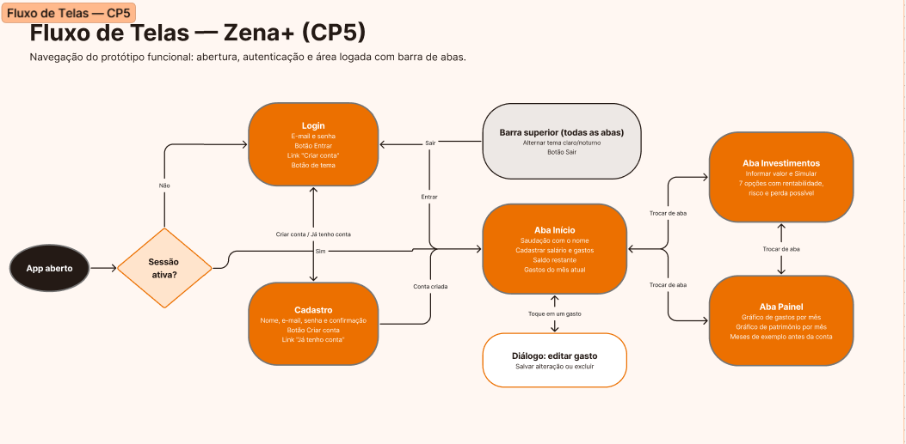
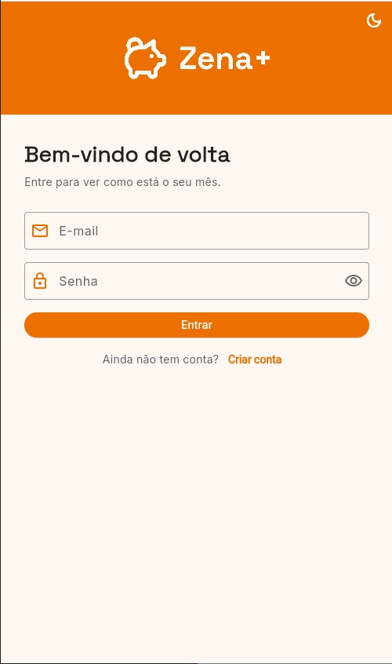
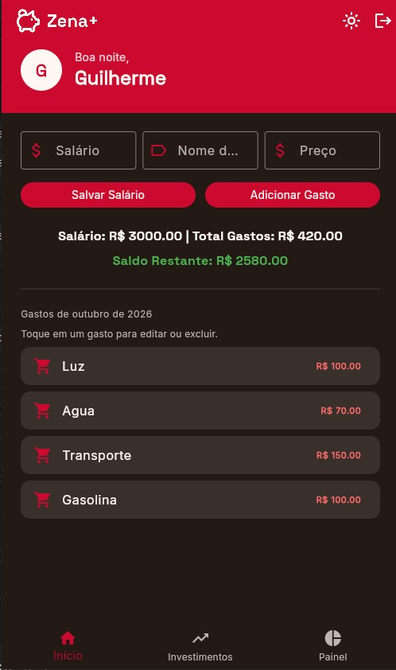
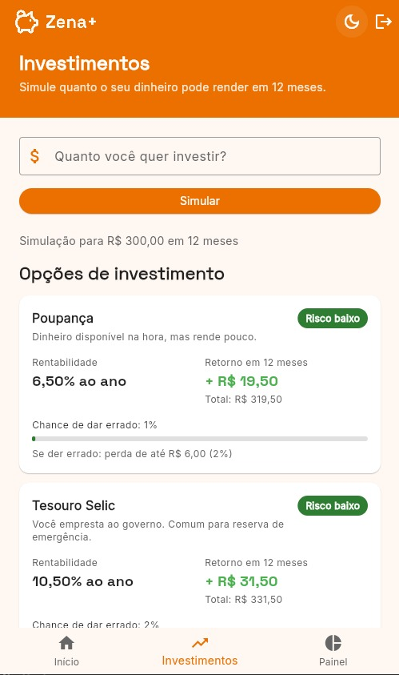
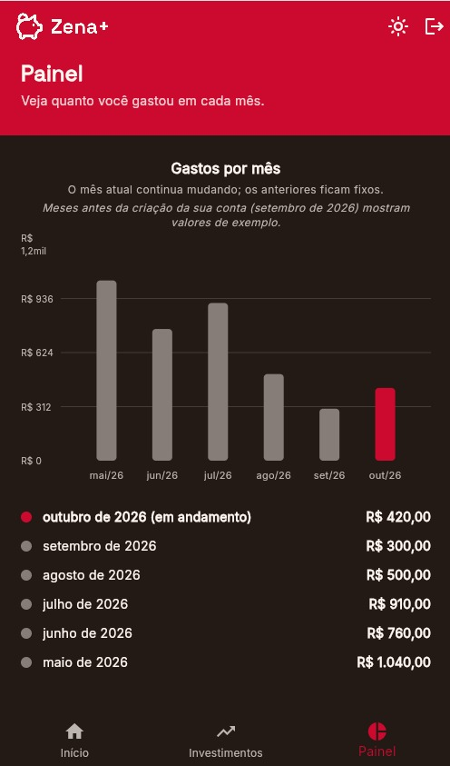
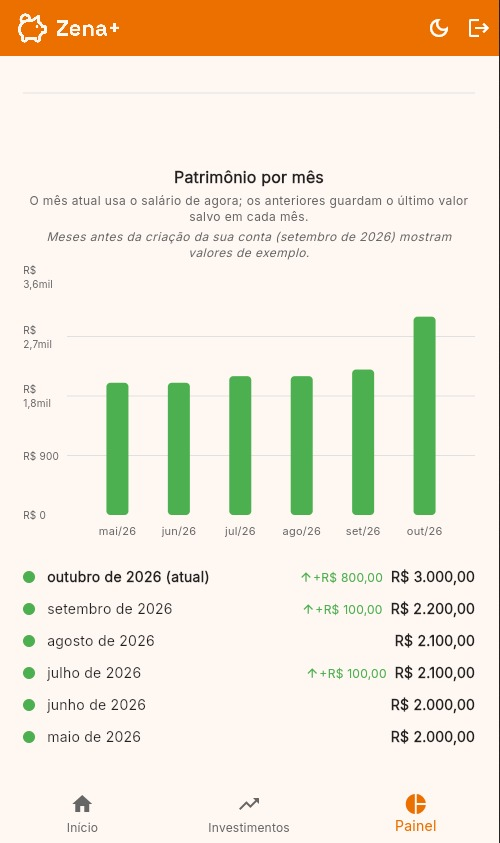
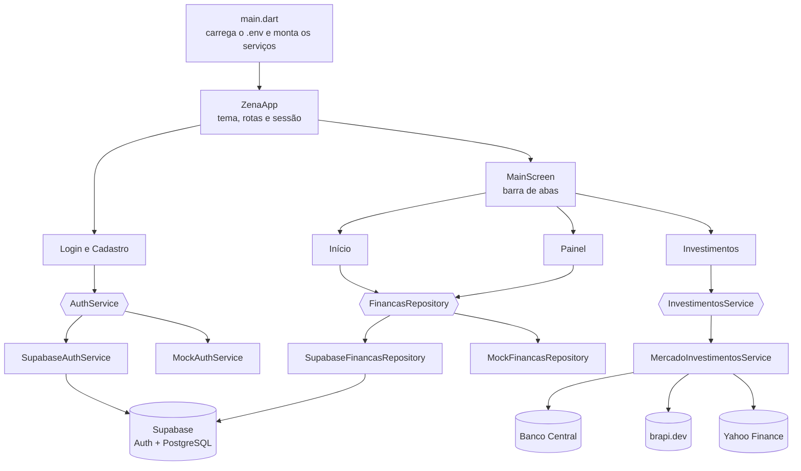
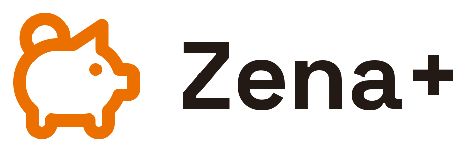
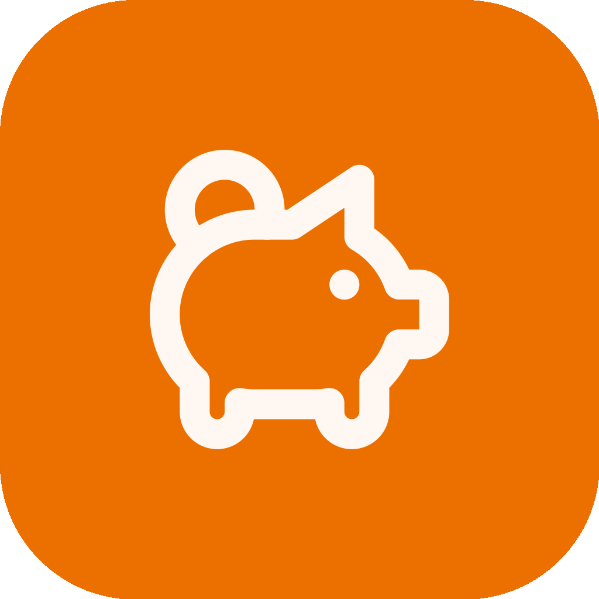
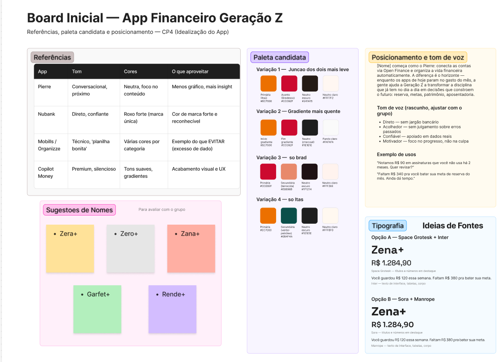

# Zena+

Organização financeira para a Geração Z.

Projeto integrado dos Checkpoints 4, 5 e 6 da disciplina **Desenvolvimento de Aplicações Multiplataforma** (FIAP · Ciência da Computação · 2º ano), com o Prof. Hercules Ramos.

| Checkpoint | Foco | Status |
| --- | --- | --- |
| CP4 | Idealização do app (marca, identidade visual, pitch, projeto inicial) | Concluído |
| CP5 | Protótipo funcional (telas navegáveis, banco de dados, ambiente de teste) | Concluído |
| CP6 | App final (MVP completo e APK instalável) | **Entrega atual** |

## Vídeo de demonstração

[](https://youtu.be/jj5pYYHI2Lw)

▶️ **[Assistir no YouTube](https://youtu.be/jj5pYYHI2Lw)**

## Download do APK

📱 **[Baixar o Zena+ para Android (zena-plus.apk)](https://github.com/Rezenderzd/cp_hercules/releases/latest/download/zena-plus.apk)**

O link sempre baixa a versão mais recente. Todas as versões ficam na página de [Releases](https://github.com/Rezenderzd/cp_hercules/releases).

| Versão | Data | O que trouxe |
| --- | --- | --- |
| v1.0.1 | 21/10/2026 | Primeira versão instalável: investimentos com dados reais e nome Zena+ no Android |
| v1.0.2 | 24/10/2026 | Card de investimentos mais claro: exemplo com R$ 1.000 antes de simular e novo texto do indicador de prejuízo |

O APK foi instalado e testado em um celular Android físico, com login pelo Supabase e as cotações das ações carregando normalmente.

**Como instalar no celular**
1. Abra o link acima no celular Android e baixe o arquivo `zena-plus.apk`.
2. Toque no arquivo baixado. Se o Android pedir, permita a instalação de "fontes desconhecidas" para o navegador ou o gerenciador de arquivos.
3. Toque em **Instalar** e abra o app **Zena+**. Se o Play Protect avisar que o app não é conhecido, toque em **Instalar mesmo assim**: o aviso aparece para qualquer app que não veio da Play Store.

## Sumário

1. [Integrantes e papéis](#integrantes-e-papéis)
2. [Sobre o produto](#sobre-o-produto)
3. [Funcionalidades do MVP](#funcionalidades-do-mvp)
4. [Fluxo de telas](#fluxo-de-telas)
5. [Imagens do app](#imagens-do-app)
6. [Dados reais e dados mockados](#dados-reais-e-dados-mockados)
7. [Arquitetura do projeto](#arquitetura-do-projeto)
8. [Decisões técnicas](#decisões-técnicas)
9. [Banco de dados (Supabase)](#banco-de-dados-supabase)
10. [Como rodar o projeto](#como-rodar-o-projeto)
11. [Testes automatizados](#testes-automatizados)
12. [Como gerar uma nova versão do APK](#como-gerar-uma-nova-versão-do-apk)
13. [Histórico do projeto](#histórico-do-projeto)
14. [Aprendizados do grupo](#aprendizados-do-grupo)
15. [Roadmap](#roadmap)
16. [Marca, identidade visual e pitch (CP4)](#marca-identidade-visual-e-pitch-cp4)

## Integrantes e papéis

| RM | Nome | Papel no projeto |
| --- | --- | --- |
| 563415 | Fernando Caires Silva | Pitch |
| 563500 | Guilherme Martins Rezende | Código |
| 563567 | Raphael Mischiatti de Souza | README e código |

## Sobre o produto

**Proposta de valor.** A visão do Zena+ é começar como o Pierre (CloudWalk): conectar a vida financeira do usuário e organizar tudo automaticamente, sem planilha e sem exigir que a pessoa vire "analista financeira de si mesma". A diferença é o horizonte: enquanto os apps de hoje param no controle do gasto do mês, o Zena+ ajuda a Geração Z a transformar a disciplina que ela já tem no dia a dia em decisões que constroem o futuro, como reserva, metas, patrimônio e aposentadoria. No CP6, o MVP entrega a base desse caminho: controle de salário e gastos com conta própria, histórico mensal em gráficos e um simulador de investimentos com dados reais do mercado.

**O problema.** Dados recentes mostram um contraste na nossa geração:

- Segundo o **Mapa da Inadimplência do Serasa (maio/2026)**, jovens de 18 a 25 anos representam apenas **11% dos inadimplentes do país**, a menor participação entre as faixas etárias (contra 33,3% na faixa 26-40 e 35,7% na faixa 41-60).
- Segundo o **Raio X do Investidor Brasileiro 2026** (Anbima + Datafolha), apenas **12% da Geração Z** já iniciou uma reserva para aposentadoria, embora **66%** pretendam começar no futuro.
- Um levantamento do setor (ClienteSA) aponta que **55%** da Geração Z se considera financeiramente organizada, o maior índice entre as gerações, mas **73%** sente que suas conquistas financeiras estão atrasadas, e **42%** diz que o dinheiro afeta diretamente a saúde mental.

Ou seja: somos a geração mais disciplinada no controle do dia a dia, mas sem estrutura para pensar em longo prazo.

**Público-alvo.** Jovens de aproximadamente 18 a 25 anos, universitários ou em início de carreira, que já usam banco digital e Pix, nunca investiram a longo prazo (ou não sabem por onde começar), não querem organizar dinheiro em planilha e valorizam marcas com linguagem direta, que não os tratem como "irresponsáveis".

## Funcionalidades do MVP

**Conta do usuário**
- Cadastro com nome, e-mail, senha e confirmação de senha, com validação dos campos.
- Login com e-mail e senha pelo Supabase Auth. A sessão fica salva: quem já entrou não precisa fazer login de novo ao abrir o app.
- O cadastro não exige confirmação por e-mail, por se tratar de um projeto acadêmico.
- Mensagens de erro em português (senha incorreta, e-mail já cadastrado, muitas tentativas etc.).

**Aba Início**
- Saudação no estilo dos apps de banco: "Bom dia / Boa tarde / Boa noite" + o primeiro nome do usuário.
- Cadastro do salário e dos gastos (nome + preço), gravados no banco do usuário.
- Saldo restante calculado automaticamente (salário − gastos do mês).
- Lista dos gastos do mês atual. Tocando em um gasto, é possível editar ou excluir.
- No dia 1º de cada mês, a lista recomeça do zero. Os gastos antigos não são apagados: continuam guardados e aparecem no histórico do Painel.

**Aba Investimentos**
- O usuário informa quanto quer investir e toca em **Simular**. Antes de simular, cada opção já mostra quanto R$ 1.000 teriam rendido.
- Seis opções com **dados reais**, carregados ao abrir a aba:
  - **Renda fixa (risco baixo):** Poupança, Tesouro Selic e CDB 100% do CDI, com as taxas oficiais do **Banco Central** (meta da Selic, CDI e TR). O rendimento da poupança segue a regra da lei: 0,5% ao mês + TR quando a Selic passa de 8,5% ao ano, ou 70% da Selic + TR abaixo disso.
  - **Ações (risco alto):** Itaú Unibanco (ITUB4), Bradesco (BBDC4) e Vivo (VIVT3), com o histórico de preços dos últimos 12 meses. O Itaú vem da **brapi.dev**; Bradesco e Vivo vêm do **Yahoo Finance**. A Bradesco Seguros não tem ação própria na bolsa, por isso o app usa a ação do Bradesco, dono da seguradora.
- Cada opção mostra a rentabilidade, o retorno em R$ em 12 meses (em vermelho quando é negativo) e a fonte do dado:
  - **Ações:** "Dias do último ano com prejuízo hoje" é a porcentagem de dias do último ano em que quem comprou estaria no prejuízo hoje. Também aparece a maior queda real dos últimos 12 meses. A rentabilidade usa o preço ajustado, que inclui os dividendos.
  - **Renda fixa:** nenhum dia com prejuízo e a garantia real (FGC até R$ 250 mil ou Tesouro Nacional).
- Se o Banco Central, a brapi.dev ou o Yahoo Finance não responderem, o app mostra as opções que carregaram e um aviso com o botão **Tentar de novo**.

**Aba Painel**
- **Gastos por mês:** gráfico de colunas com o total gasto em cada um dos últimos 6 meses. A coluna do mês atual muda conforme gastos são adicionados, editados ou excluídos; os meses anteriores ficam fixos.
- **Patrimônio por mês:** gráfico de colunas com o salário de cada mês, mostrando aumento ou queda em relação ao mês anterior. O mês atual usa o salário atual; cada mês passado guarda o último valor salvo nele.

**Em todas as telas**
- Botão para alternar entre modo claro e modo noturno.
- Botão de sair da conta.

## Fluxo de telas

O fluxo completo, com o que cada tela faz, está no board do projeto no Figma, logo abaixo do board inicial do CP4: [ver fluxo de telas no Figma](https://www.figma.com/board/SDKAwifTkTvITRMQaGuYjY/board-inicial-cp4?node-id=63-57).



1. Ao abrir, o app verifica se já existe uma sessão ativa: se sim, vai direto para a aba **Início**; se não, abre o **Login**. Quem ainda não tem conta vai para o **Cadastro**.
2. Depois de entrar, o usuário cai na aba **Início**, onde cadastra o salário e os gastos do mês.
3. Na aba **Investimentos**, informa um valor e compara quanto cada opção pode render em 12 meses.
4. Na aba **Painel**, acompanha os gastos e o patrimônio dos últimos 6 meses.
5. O botão de sair volta para o Login, e o botão de tema alterna entre claro e noturno em qualquer aba.

## Imagens do app

Prints do app rodando, nos modos claro e noturno.

| Login | Início (modo noturno) |
| --- | --- |
|  |  |

| Investimentos | Painel: gastos por mês (modo noturno) | Painel: patrimônio por mês |
| --- | --- | --- |
|  |  |  |

Nos gráficos do Painel, a conta foi criada em setembro de 2026: os meses de maio a agosto mostram valores de exemplo, e setembro e outubro mostram os dados reais do usuário.

## Dados reais e dados mockados

**Dados reais**

| Dado | De onde vem |
| --- | --- |
| Conta, nome, salário, gastos e histórico de salário | Supabase (banco PostgreSQL do grupo) |
| Taxas da renda fixa (meta da Selic, CDI e TR) | API pública do Banco Central (séries 432, 4389 e 226 do SGS) |
| Cotação do Itaú (ITUB4) | brapi.dev, sem cadastro |
| Cotações do Bradesco (BBDC4) e da Vivo (VIVT3) | Yahoo Finance, sem cadastro (fonte não oficial) |

**Dados mockados**

| O que é simulado | Onde está | Por quê |
| --- | --- | --- |
| **Histórico dos gráficos antes da conta existir** | `lib/data/historico_mock.dart` | Um valor de gastos e um de patrimônio para cada mês do calendário (ex.: R$ 500 de gastos em agosto, R$ 2.000 de patrimônio em junho). Aparecem só nos meses **anteriores à criação da conta**, para o usuário já ver um histórico no primeiro acesso. O próprio gráfico avisa quais meses são de exemplo. |
| **Modo de demonstração** | `lib/services/mock_auth_service.dart` e `mock_financas_repository.dart` | Usado só quando o `.env` está vazio ou o Supabase não responde. O login aceita qualquer e-mail válido e senha com 6 ou mais caracteres, e salário e gastos ficam em memória até fechar o app. Serve para rodar o projeto sem conta no Supabase. |

## Arquitetura do projeto

O app é dividido em camadas. As telas só conhecem **contratos** (classes abstratas); quem decide qual implementação usar é o `main.dart`, na abertura do app.



| Camada | Pasta | Responsabilidade |
| --- | --- | --- |
| Telas | `lib/screens/` | Montar a interface e reagir ao usuário. Não sabem de onde vêm os dados. |
| Componentes | `lib/widgets/` | Peças reutilizáveis: botões, campos, cards, gráficos, cabeçalhos. |
| Contratos e serviços | `lib/services/` | Contratos (`AuthService`, `FinancasRepository`, `InvestimentosService`) e suas implementações: Supabase, modo de demonstração e APIs de mercado. |
| Modelos | `lib/models/` | Os dados do app: `Gasto`, `SalarioMensal`, `Investimento`. |
| Regras e utilitários | `lib/core/utils/` | Cálculos puros, sem tela: gastos por mês, histórico de salário, rendimento da poupança, métricas das ações, formatação de moeda, validações. |
| Design system | `lib/core/theme/` | Cores, tipografia e temas claro e noturno. |
| Dados de exemplo | `lib/data/` | Histórico mockado dos gráficos. |

**Como um dado percorre o app (exemplo: adicionar um gasto)**
1. Na aba Início, o usuário preenche nome e preço e toca em **Adicionar Gasto**.
2. A tela chama `adicionarGasto()` do `FinancasRepository`, sem saber qual banco está por trás.
3. A implementação do Supabase grava a linha na tabela `gastos`; o banco preenche `user_id` e `created_at`.
4. A tela atualiza a lista e o saldo. Ao abrir o Painel, o gasto entra na coluna do mês atual, porque os gráficos agrupam pela data `created_at`.

**Estrutura de pastas**

```
cp_hercules/
├── .github/workflows/
│   └── gerar-apk.yml             gera o APK e publica em Releases
├── assets/                       logo usado dentro do app
├── imagens/                      imagens do README (prints, fluxo de telas, logos)
├── lib/
│   ├── main.dart                 carrega o .env, monta os serviços e abre o app
│   ├── app.dart                  MaterialApp, temas e rotas
│   ├── env.dart                  leitura das chaves do .env
│   ├── core/
│   │   ├── routes.dart           nomes das rotas
│   │   ├── theme/                cores, tipografia, tema claro/noturno
│   │   └── utils/                cálculos por mês, investimentos, moeda, saudação, validações
│   ├── data/
│   │   └── historico_mock.dart   meses antes da criação da conta nos gráficos
│   ├── models/                   Gasto, Investimento, SalarioMensal
│   ├── services/                 contratos e implementações (Supabase, demonstração, mercado)
│   ├── screens/
│   │   ├── login/                login e cadastro
│   │   ├── main/                 tela com a barra de abas
│   │   ├── home/                 aba Início
│   │   ├── investimentos/        aba Investimentos
│   │   └── dashboard/            aba Painel
│   └── widgets/                  componentes reutilizáveis
├── test/                         testes automatizados
├── pubspec.yaml                  dependências do projeto
└── .env                          chaves do Supabase (só na sua máquina, fora do Git)
```

## Decisões técnicas

**Evolução entre os Checkpoints**

| Aspecto | CP4 | CP5 | CP6 |
| --- | --- | --- | --- |
| Telas | Uma tela única | Login, cadastro e três abas | Mantidas, com textos revisados após testes no celular |
| Dados do usuário | Na memória | Supabase, separado por usuário | Supabase, separado por usuário |
| Investimentos | Não existiam | Simulador com dados mockados | Dados reais do Banco Central, da brapi.dev e do Yahoo Finance |
| Gráficos | Não existiam | Gastos e patrimônio por mês | Histórico de exemplo só antes da criação da conta |
| Entrega | Projeto rodando | Rodando no emulador e no Chrome | APK instalável, gerado pelo GitHub Actions |
| Nome no Android | `cp4_hercules` | `cp4_hercules` | Zena+ |
| Código | Um único `main.dart` | Organizado em camadas | Camadas + serviço de mercado + 95 testes |

**Principais decisões**

- **Telas que não conhecem a fonte dos dados.** As telas usam contratos (`AuthService`, `FinancasRepository`, `InvestimentosService`), e o Supabase, o modo de demonstração e as APIs de mercado são implementações deles. Trocar de fonte não exige mudar nenhuma tela, e os testes usam implementações falsas no lugar das reais (inversão de dependência, o "D" do SOLID, como na Aula 18).
- **Supabase como backend.** PostgreSQL relacional, autenticação pronta e segurança por usuário (RLS), o que encaixa com salário e gastos separados por pessoa.
- **Chaves no `.env` com `flutter_dotenv`** (Aula 18), para não deixar credenciais no código nem no GitHub. No GitHub Actions, as mesmas chaves ficam em Secrets.
- **Dados de mercado de fontes gratuitas e sem cadastro.** Renda fixa pela API oficial do Banco Central; ações pela brapi.dev (Itaú) e pelo Yahoo Finance (Bradesco e Vivo), que não exigem chave.
- **Indicadores calculados, não estimados.** Nas ações, "dias com prejuízo" e "maior queda" saem do histórico real de preços; na renda fixa, a garantia é a do FGC ou do Tesouro Nacional.
- **Falha parcial em vez de tela vazia.** Cada fonte de mercado é buscada separadamente: se uma falhar, as outras continuam aparecendo, com um aviso e o botão **Tentar de novo**.
- **"Reset" mensal sem apagar dados.** Os gastos não são excluídos no dia 1º: o app filtra pelo mês de criação, e o histórico do Painel continua completo.
- **Histórico de salário com um registro por mês**, gravado com `upsert` e chave única (`user_id`, `mes`): salvar de novo no mesmo mês atualiza o registro em vez de duplicar.
- **Navegação por abas** com `BottomNavigationBar`, seguindo o Guia Prático "Do Figma ao Código Flutter".
- **Estado sem pacote extra.** A troca de tema usa `ChangeNotifier` + `ListenableBuilder`, nativos do Flutter.
- **APK gerado na nuvem.** O GitHub Actions instala o Flutter, cria o `.env` a partir dos Secrets, gera o APK e o publica em Releases, sem depender da máquina de ninguém.

**Tecnologias:** Flutter e Dart · Supabase (`supabase_flutter`) · `flutter_dotenv` · `fl_chart` (gráficos) · `http` (busca das taxas e cotações) · API pública do Banco Central · brapi.dev e Yahoo Finance · `google_fonts` (Space Grotesk e Inter) · `flutter_test` e `flutter_lints` · GitHub Actions · Figma · Android Studio e VS Code · GitHub.

## Banco de dados (Supabase)

Usado no APK publicado e na [Opção 2](#opção-2-com-o-supabase) de execução. E-mail e senha ficam na tabela interna do Supabase Auth (`auth.users`), com a senha guardada como hash. As tabelas do app são:

| Tabela | Colunas | Para que serve |
| --- | --- | --- |
| `profiles` | `id`, `nome`, `salario`, `created_at` | Um registro por usuário, com o nome e o salário atual. |
| `gastos` | `id`, `user_id`, `nome`, `preco`, `created_at` | Cada gasto do usuário. A data `created_at` define em qual mês ele entra. |
| `salarios_mensais` | `id`, `user_id`, `mes`, `valor`, `atualizado_em` | Histórico do salário, um registro por usuário por mês (chave única em `user_id` + `mes`). Salvar de novo no mesmo mês atualiza o registro em vez de duplicar. |

Todas as tabelas usam **RLS** (Row Level Security): cada usuário só enxerga e altera os próprios dados.

## Como rodar o projeto

**Pré-requisitos**
- Flutter instalado (Dart 3.12 ou superior), com VS Code ou Android Studio.
- Um emulador Android configurado no Android Studio (ambiente usado na demonstração). O Google Chrome também funciona.

### Opção 1: modo de demonstração (recomendado para testar)

Não precisa de conta no Supabase.

**1. Baixar o projeto**
```bash
git clone https://github.com/Rezenderzd/cp_hercules.git
cd cp_hercules
```

**2. Criar um arquivo `.env` vazio na raiz do projeto** (na mesma pasta do `pubspec.yaml`). Ele precisa existir para o projeto compilar, mesmo vazio.
```bash
# Linux / macOS / Git Bash
touch .env

# Windows (PowerShell)
New-Item .env -ItemType File
```

**3. Instalar as dependências**
```bash
flutter pub get
```

**4. Abrir o emulador e rodar**

Abra o emulador pelo Android Studio (Device Manager → ▶) ou pelo terminal:
```bash
flutter emulators
flutter emulators --launch <id_do_emulador>
```
Com o emulador aberto:
```bash
flutter run
```
Para rodar no navegador: `flutter run -d chrome`.

**5. Entrar no app**

Use qualquer e-mail válido e uma senha com 6 ou mais caracteres (ex.: `teste@zena.com` / `123456`), ou crie uma conta na tela de cadastro.

### Opção 2: com o Supabase

Para gravar os dados em um banco real, preencha o `.env` com os dados de um projeto seu no Supabase (Project Settings → API Keys):

```
SUPABASE_URL=https://SEU-PROJECT-ID.supabase.co
SUPABASE_ANON_KEY=sb_publishable_xxxxxxxx
```

- Use apenas a chave **publishable** (pública). A chave secreta nunca vai no app.
- O `.env` está no `.gitignore` e não deve ir para o GitHub.
- O projeto precisa ter as tabelas descritas em [Banco de dados](#banco-de-dados-supabase). O grupo usou o próprio projeto Supabase durante o desenvolvimento.
- Em **Authentication → Sign In / Providers → Email**, deixe o provedor de e-mail **ligado** e o **Confirm email desligado**.
- Depois de editar o `.env`, reinicie o app com **hot restart** (tecla `R` maiúscula). O hot reload não recarrega o `.env`.

Se o Supabase não responder ou o `.env` estiver vazio, o app volta sozinho para o modo de demonstração.

### Testes
```bash
flutter test
```

### Problemas comuns
- *"The asset file '.env' doesn't exist"*: o arquivo `.env` não foi criado (passo 2).
- *"Building with plugins requires symlink support"* (Windows): ative o Modo de Desenvolvedor do Windows.
- *"Muitas tentativas"*: limite de requisições do Supabase. Espere alguns minutos ou aumente o limite em Authentication → Rate Limits.

## Testes automatizados

São **95 testes em 9 arquivos**, em `test/`. Eles cobrem as regras de negócio sem precisar abrir o app e usam implementações falsas no lugar do Supabase e das APIs de mercado, então rodam sem internet:

| Arquivo | O que testa |
| --- | --- |
| `utils_test.dart` | Primeiro nome, nome a partir do e-mail e saudação pelo horário |
| `gastos_mensais_test.dart` | Gastos do mês atual e totais por mês, incluindo a virada do ano |
| `salarios_mensais_test.dart` | Histórico de salário mês a mês e uso do salário atual |
| `historico_mock_test.dart` | Valores de exemplo só antes do mês de criação da conta |
| `financas_test.dart` | Repositório do modo de demonstração e leitura dos dados do Supabase |
| `calculos_investimentos_test.dart` | Rendimento da poupança, rentabilidade, dias com prejuízo e maior queda |
| `mercado_investimentos_service_test.dart` | Busca no Banco Central, na brapi.dev e no Yahoo Finance com respostas simuladas, inclusive quando uma fonte falha |
| `investimentos_test.dart` | Tela de investimentos: simulação, exemplo com R$ 1.000, ordem por risco e aviso de falha |
| `widget_test.dart` | Fluxos das telas: login, cadastro, abas, edição de gastos, gráficos e modo noturno |

Para rodar: `flutter test`.

## Como gerar uma nova versão do APK

O APK não é gerado na máquina de ninguém: o GitHub gera e publica sozinho, pelo workflow `.github/workflows/gerar-apk.yml`.

**1. Cadastrar as chaves do Supabase no GitHub (uma vez só)**

No repositório, vá em **Settings → Secrets and variables → Actions → New repository secret** e crie dois secrets, com os mesmos valores do seu `.env`:

| Nome do secret | Valor |
| --- | --- |
| `SUPABASE_URL` | `https://SEU-PROJECT-ID.supabase.co` |
| `SUPABASE_ANON_KEY` | `sb_publishable_xxxxxxxx` |

Sem esses secrets, o APK é gerado mesmo assim, mas abre em modo de demonstração.

**2. Gerar o APK**

Escolha uma das duas formas:
- **Pelo site:** aba **Actions → Gerar APK → Run workflow**.
- **Por uma tag de versão:**
  ```bash
  git tag v1.0.0
  git push origin v1.0.0
  ```

Em alguns minutos, a nova versão aparece em [Releases](https://github.com/Rezenderzd/cp_hercules/releases) com o arquivo `zena-plus.apk`, e o link de download do topo deste README passa a apontar para ela.

## Histórico do projeto

O histórico de commits acompanha a evolução entre os Checkpoints:

| Checkpoint | Período | Principais commits |
| --- | --- | --- |
| CP4 | agosto de 2026 | Base do projeto Flutter, estilização com a identidade visual e imagens do README |
| CP5 | setembro e outubro de 2026 | Login, cadastro, abas de Início, Investimentos e Painel, gráficos de gastos e patrimônio, histórico de exemplo nos gráficos e README com prints |
| CP6 | outubro de 2026 | Investimentos com dados reais, geração do APK pelo GitHub Actions (v1.0.1) e card de investimentos revisado (v1.0.2) |

## Aprendizados do grupo

- **Separar a tela da fonte dos dados compensou.** Como as telas dependem só de contratos, trocamos os investimentos mockados por dados reais e ligamos o Supabase sem reescrever as telas. Os testes também ficaram simples, porque basta passar uma implementação falsa.
- **Backend também se configura fora do código.** Boa parte dos erros com o Supabase não estava no Flutter: o provedor de e-mail desligado (`email_provider_disabled`), o limite de tentativas de login e a confirmação de e-mail ligada. Aprendemos a ler o código do erro no console antes de mexer no app.
- **Credenciais não vão para o Git.** As chaves ficam no `.env` (fora do repositório) e nos Secrets do GitHub, e só a chave pública do Supabase vai dentro do app.
- **O mesmo código se comporta diferente em cada plataforma.** As cotações do Yahoo Finance carregavam no celular, mas o Chrome bloqueava o pedido (CORS). Por isso, o teste final passou a ser feito no APK, que é a entrega do CP6.
- **Dado real precisa de explicação.** Ao testar no celular, vimos que "chance de prejuízo: 55%" ao lado de "+4,06%" confundia quem lia. Reescrevemos o card para dizer exatamente o que cada número mede e mostrar um exemplo em reais.
- **Datas resolvem melhor que exclusões.** Para "zerar" os gastos todo dia 1º, filtramos pelo mês de criação em vez de apagar registros, e o histórico dos gráficos continuou completo.
- **Git em grupo pede cuidado.** Editar o README ao mesmo tempo gerou um conflito de merge, e aplicar só parte de uma atualização deixou o projeto sem compilar. Passamos a puxar as mudanças antes de editar e a conferir o projeto inteiro antes do push.
- **Automatizar a entrega economiza tempo.** Com o GitHub Actions, cada nova versão do APK sai com um clique, sempre do mesmo jeito.

## Roadmap

| Etapa | Situação |
| --- | --- |
| APK instalável publicado em Releases | Concluído no CP6 |
| Investimentos com dados reais | Concluído no CP6 |
| Ícone do Zena+ no launcher Android | Pendente: o app ainda usa o ícone padrão do Flutter |
| Conexão via Open Finance (importar contas e cartões automaticamente) | Planejado. Hoje os gastos são cadastrados manualmente. |
| Categorização automática de gastos | Planejado |
| Alertas inteligentes (assinaturas esquecidas, gasto fora do padrão) | Planejado |
| Metas de reserva e objetivos de longo prazo | Planejado |
| Simulação "eu no futuro" | Primeiros passos: simulador de investimentos e histórico de patrimônio no Painel |

## Marca, identidade visual e pitch (CP4)

Conteúdo definido no CP4 e mantido como referência. Clique para expandir.

<details>
<summary><b>Marca</b></summary>

- **Nome:** Zena+ mantém o "Z" como referência direta à Geração Z, e o "+" reforça a proposta central da marca: depois de organizar o básico, sempre tem um próximo passo (guardar, investir, crescer). O nome soa como um nome próprio curto, no mesmo espírito humanizado da concorrência, o que facilita um tom de voz mais pessoal e menos corporativo.
- **Tom de voz:** direto, acolhedor, confiável, motivador (sem julgamento sobre erros passados).
- Exemplos de uso:
  - "Notamos R$ 90 em assinaturas que você não usa há 2 meses. Quer revisar?"
  - "Faltam R$ 340 pra você bater sua meta de reserva do mês. Ainda dá tempo."

</details>

<details>
<summary><b>Identidade visual</b></summary>

- **Paleta:** laranja Itaú (`#EC7000`) como cor primária + vermelho Bradesco (`#CC092F`) como acento, com neutros quentes (`#241A15` / `#FFF7F2`).
- **Tipografia:** Space Grotesk (títulos e números em destaque) + Inter (interface, tabelas, corpo), via pacote `google_fonts`.
- **Logo:** ícone de porquinho (cofrinho) + wordmark "Zena+":
  - `zena-logo-dark-bg.png`: porquinho e wordmark em creme, para fundos laranja/escuros (usado no cabeçalho do app).
  - `zena-logo-light-bg.png`: porquinho em laranja e wordmark em grafite, para fundos claros.
  - `zena-logo-icon.png`: ícone quadrado com fundo laranja, para o launcher do app (ainda não aplicado; veja o Roadmap).
- Board de ideias completo: [ver no Figma](https://www.figma.com/board/SDKAwifTkTvITRMQaGuYjY).

| Logo para fundo escuro | Logo para fundo claro | Ícone do app |
| --- | --- | --- |
|  |  |  |



</details>

<details>
<summary><b>Pitch: por que o Zena+ existiria no mercado</b></summary>

**Diferencial competitivo:** o Pierre e os apps de organização financeira param no controle do gasto do mês. Apps tradicionais de planilha (Mobills, Organizze) exigem esforço manual de categorização. O Zena+ ocupa o espaço entre os dois: a mesma simplicidade de uso do Pierre, mas com o olhar de longo prazo que nenhum dos dois oferece hoje, construído por quem já trabalha dentro do mercado financeiro e conhece as dores reais desse público.

**Modelo de negócio (proposto):**
- **Freemium:** organização básica (cadastro manual, depois conexão via Open Finance, alertas simples) gratuita.
- **Assinatura premium:** funcionalidades avançadas (simulação de aposentadoria, metas múltiplas, relatórios aprofundados).
- **Parcerias financeiras (fase futura):** comissionamento por indicação de produtos de investimento/reserva dentro do app, aproveitando a experiência do grupo no setor bancário para validar parceiros confiáveis.

</details>
